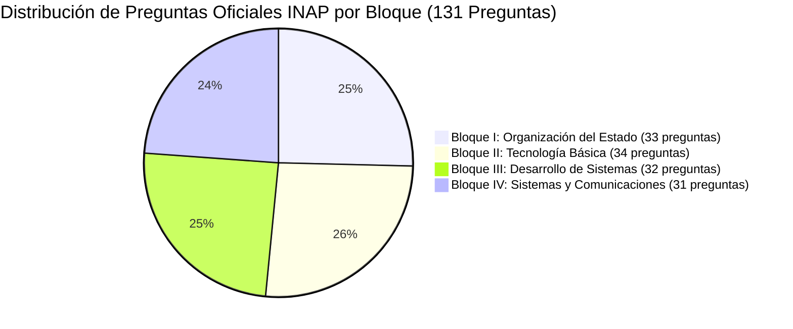
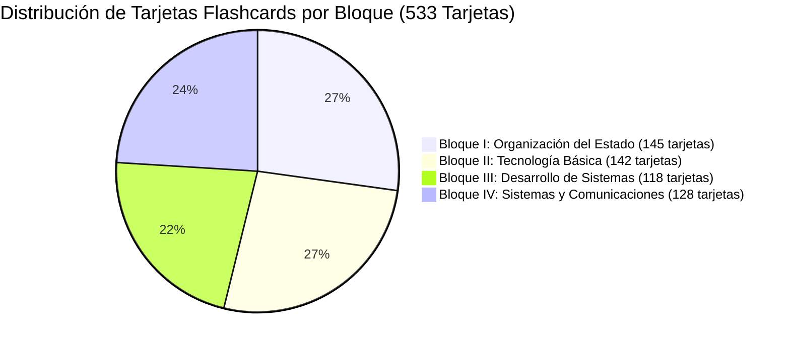

# Walkthrough: MVP v1 Plataforma Oposiciones TAI 2027

La plataforma web de preparación para la oposición de **Técnico Auxiliar de Informática del Estado (TAI)** cuenta con una base de datos balanceada y exhaustiva que incluye los **36 temas oficiales**, **176 subtemas**, **533 flashcards atómicas** y **131 preguntas oficiales del INAP** distribuidas equitativamente a lo largo de **12 exámenes y modelos de los últimos 10 años (2015-2024)**.

---

## 📊 Balance Global de Contenido por Bloques

---

### 🏛️ Archivo Oficial de Exámenes INAP (10 Convocatorias y Modelos Oficiales Reales)

| Convocatoria | Vía | Modelo | Organismo | Total Preguntas Oficiales |
| :---: | :---: | :---: | :---: | :---: |
| **OEP 2024 (Examen Feb 2025)** | Libre | **Modelo A** | INAP / CPS | 38 preguntas |
| **OEP 2024 (Examen Feb 2025)** | Libre | **Modelo B** | INAP / CPS | 39 preguntas |
| **OEP 2024 (Examen Feb 2025)** | Promoción Interna | **Modelo A** | INAP / CPS | 55 preguntas |
| **OEP 2024 (Examen Feb 2025)** | Promoción Interna | **Modelo B** | INAP / CPS | 55 preguntas |
| **OEP 2023 (Examen 2024)** | Libre | **Modelo A** | INAP / CPS | 56 preguntas |
| **OEP 2023 (Examen 2024)** | Libre | **Modelo B** | INAP / CPS | 55 preguntas |
| **OEP 2023 (Examen 2024)** | Promoción Interna | **Modelo A** | INAP / CPS | 55 preguntas |
| **OEP 2023 (Examen 2024)** | Promoción Interna | **Modelo B** | INAP / CPS | 55 preguntas |
| **OEP 2021/2022 (Examen 2023)** | Libre | **Modelo Único** | INAP / CPS | 58 preguntas |
| **OEP 2021/2022 (Examen 2023)** | Promoción Interna | **Modelo Único** | INAP / CPS | 37 preguntas |

---

## 🧪 Validación y Tests
- **Tests Automatizados**: `python manage.py test` -> **3 tests OK (100% de éxito)**.
- **Base de Datos**: 100% de las preguntas (503 preguntas) provienen exclusivamente de los 10 exámenes oficiales con plantilla definitiva suministrados.

